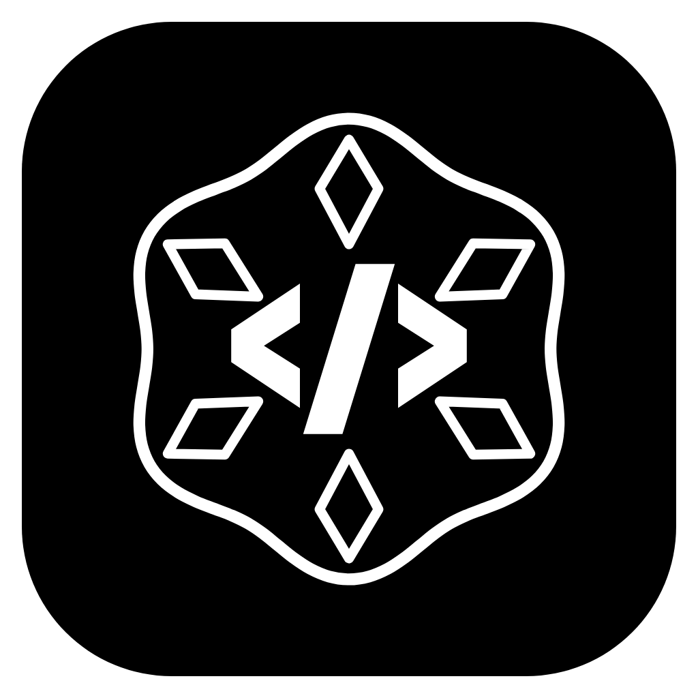
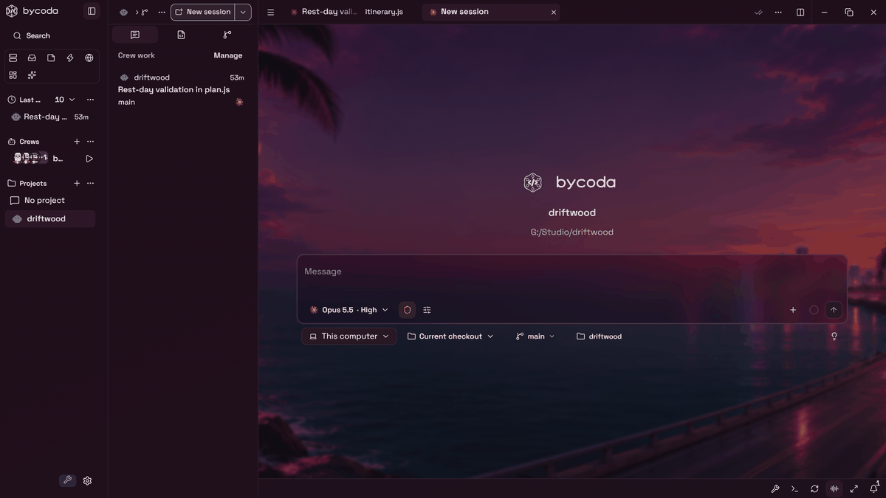
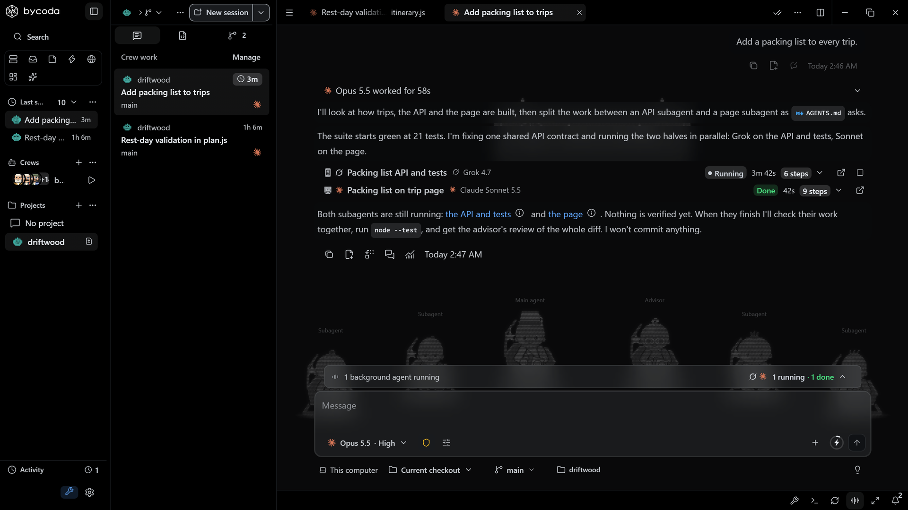
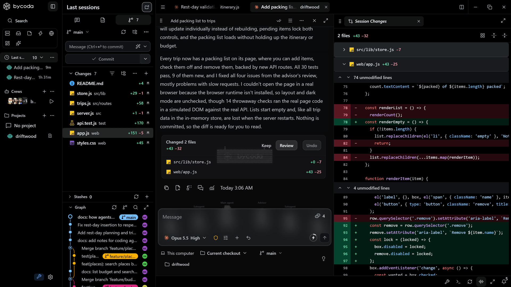

<p align="center">
  
</p>

<h1 align="center">bycoda</h1>

<p align="center">
  A desktop app that runs your coding agents, with their sessions, files, terminals and Git in one window.
</p>

<p align="center">
  <a href="#quick-start">Quick start</a> ·
  <a href="docs/README.md">Documentation</a> ·
  <a href="https://github.com/bahadryalcn/bycoda/issues">Issues</a> ·
  <a href="LICENSE">MIT license</a>
</p>

<p align="center">
  
</p>

<p align="center"><sub>Six themes generated from short descriptions in Settings > Appearance, each with its own background picture.</sub></p>

## Overview

bycoda runs the agent CLIs you already use (Claude Code, Codex, Gemini CLI, Grok, OpenCode and others) and keeps
their sessions next to the project they work on. You read the conversation, open the files it touched, run
commands and review the diff in the same window. Sign-in and model access come from your own provider accounts;
bycoda does not proxy or resell AI access.

The desktop app is built with Tauri (Rust) and React. A separate Node Host process owns sessions, projects and
remote connections, so work keeps running when the window is closed.

## Features

- Run several agents side by side and keep each project's history. Existing local Claude Code and Codex
  conversations can be imported.
- Let a session hand work to subagents from other providers, and pick an advisor model that reviews the result.
- Read the diff of every change, keep or undo it, and let the app draft the commit message.
- Queue tasks on a board that runs them through review, and schedule automations for work that repeats.
- Put a crew of specialist agents on one piece of work.
- Hand GitHub or Jira issues from the Inbox to an agent.
- Save SSH servers and work on them from the app.
- Keep notes per project, talk to the voice assistant, and approve requests from the mobile app.
- Work with projects on another machine through its Host. See [remote access](docs/guides/remote-access.md).
- Change the light and dark schemes, palettes, fonts and density, or describe a theme and let a model of your
  choice build it.
- Use the interface in several languages.

What each provider supports, and which models it offers, depends on its integration.

<table>
  <tr>
    <td><a href="public/brand/bycoda-session.png"></a></td>
    <td><a href="public/brand/bycoda-review.png"></a></td>
  </tr>
  <tr>
    <td align="center"><sub>One session, two subagents from two providers</sub></td>
    <td align="center"><sub>The diff beside the conversation</sub></td>
  </tr>
</table>

<p align="center"><sub>The screenshots show a demo project.</sub></p>

## Quick start

Requirements:

- Node.js 24.11 or newer (see [.nvmrc](.nvmrc))
- pnpm, at the version pinned in [package.json](package.json)
- Rust and the [Tauri prerequisites](https://tauri.app/start/prerequisites/) for your platform
- At least one supported provider CLI, installed and signed in

```sh
git clone https://github.com/bahadryalcn/bycoda.git
cd bycoda
pnpm install --frozen-lockfile
pnpm run tauri dev
```

On first launch, setup asks three things in order. Choose this computer or a remote Host, check the installed
provider CLIs, then add a project folder or import existing conversations. Nothing is installed or imported without your
choice. Details: [getting started](docs/guides/onboarding.md).

For local packaging and installation on Windows or macOS, see
[local builds](docs/local-update.md). Release builds update themselves from signed
releases; see [releases and updates](docs/reference/fork.md#releases-and-updates).

## Documentation

| Topic                                                    | Covers                                                  |
| -------------------------------------------------------- | ------------------------------------------------------- |
| [Getting started](docs/guides/onboarding.md)             | Agents, projects, importing conversation history        |
| [Remote access](docs/guides/remote-access.md)            | Working with a Host on another machine                  |
| [Project privacy](docs/guides/project-privacy.md)        | Project group locking and visibility                    |
| [Local builds](docs/local-update.md)                     | Packaging and installing on Windows and macOS           |
| [Repository layout](docs/reference/repository-layout.md) | Where application code, scripts and tests live          |
| [Documentation index](docs/README.md)                    | Integrations, localization, Host and reference material |

## Privacy

Sharing installation statistics or daily token totals and estimated costs is
off by default. Diagnostic reports ask for approval by default. Workspace data
stays on your machines and on the services you connect. Provider subscriptions,
quotas and charges are governed by each provider's terms.

- [Privacy policy](docs/guides/privacy-policy.md)
- [Terms of use](docs/guides/terms-of-use.md)
- [Third-party services and data controls](docs/guides/third-party-data.md)

The app also shows them offline, in English and Turkish, under Settings > Policies.
Contact: [info@bycoda.codes](mailto:info@bycoda.codes).

## Contributing

Bug reports, feature requests and pull requests are welcome. Start with
[CONTRIBUTING.md](CONTRIBUTING.md); report security issues privately as described
in [SECURITY.md](SECURITY.md).

## Credits

bycoda is developed by [Bahadır Halil Yalçın](https://github.com/bahadryalcn). Third-party code, artwork and
sounds keep their authors and licenses; see [CREDITS.md](CREDITS.md) and [NOTICE](NOTICE).

## License

[MIT](LICENSE).
