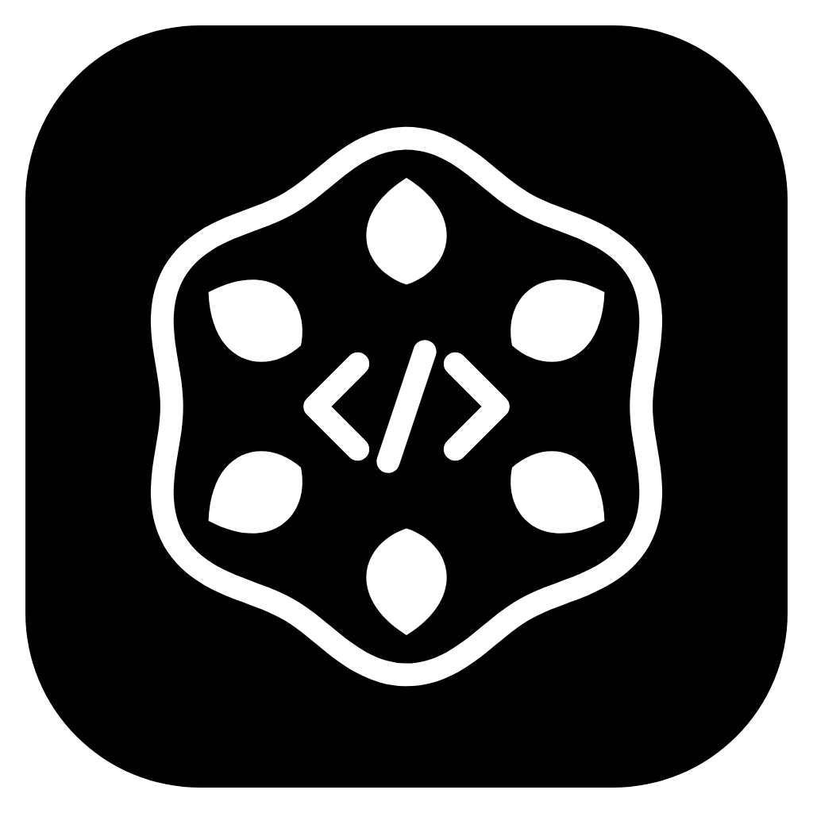
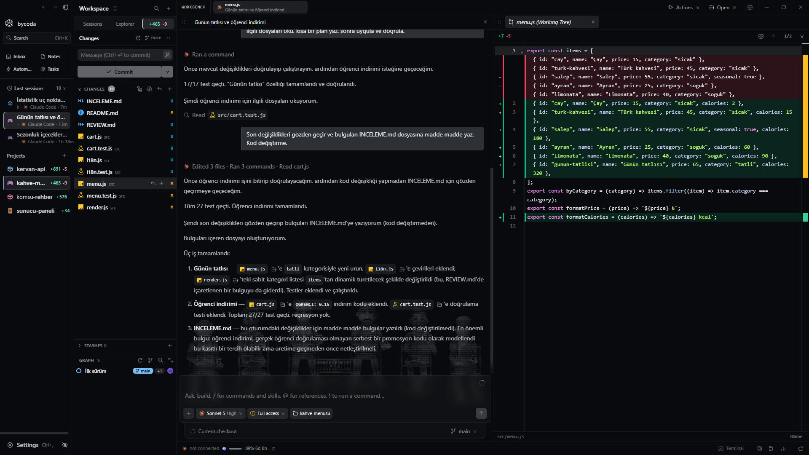
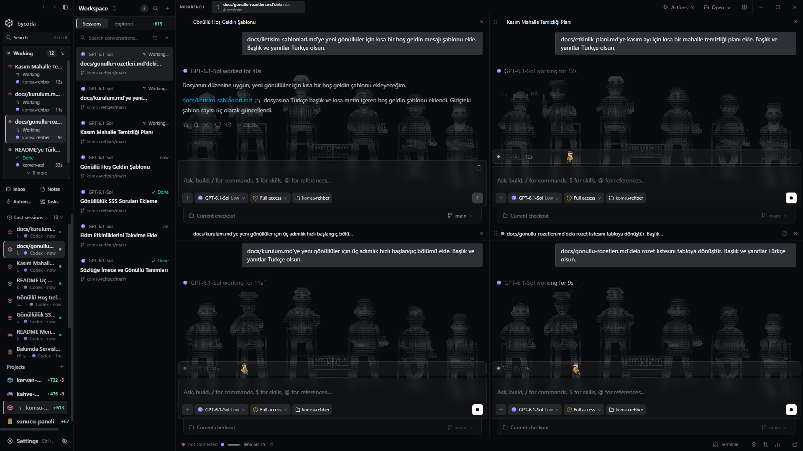
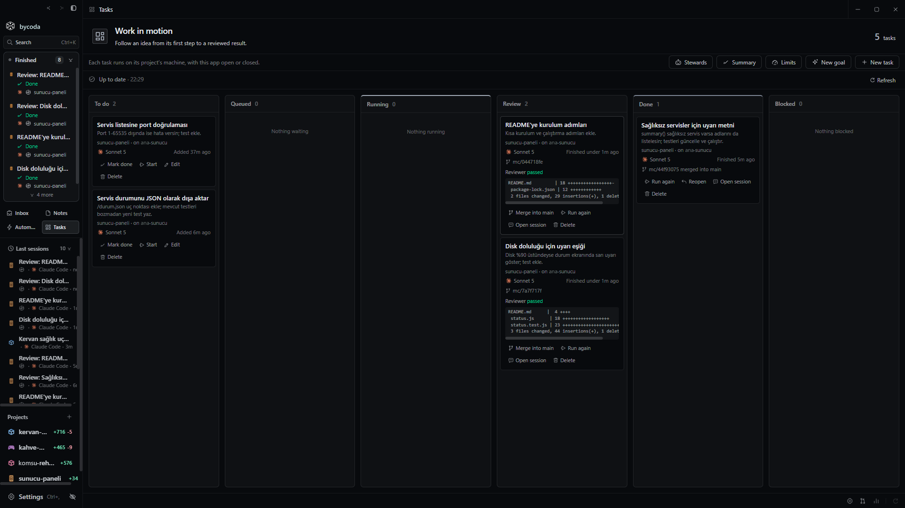

<p align="center">
  
</p>

<h1 align="center">bycoda</h1>

<p align="center">
  <strong>Your agents. Your projects. One place to build.</strong>
</p>

<p align="center">
  Turn a coding conversation into work you can inspect, refine, and ship.<br />
  A desktop workspace for AI agents, code, terminals, and Git.
</p>

<p align="center">
  <a href="#get-started">Get started</a> ·
  <a href="#why-bycoda">Explore the workspace</a> ·
  <a href="docs/README.md">Read the docs</a> ·
  <a href="https://github.com/bahadryalcn/bycoda/issues">Share an idea</a>
</p>

<p align="center">
  <strong>Bring your own provider accounts</strong> · Open source · MIT licensed
</p>

<p align="center">
  
</p>

<p align="center"><sub>Real application screens from the product video, using demo projects.</sub></p>

---

Coding with an agent is more than sending a prompt. You need to follow its work,
open the files it changes, run commands, review a diff, and pick up the conversation
later. **bycoda brings that workflow into one project workspace**, so your
conversation and the code it produces stay close together.

Use the provider CLIs you already know, with your own accounts. Keep projects and
sessions organized. Move from an idea to a reviewed change without losing the
thread.

## Why bycoda?

| What you want to do                  | What the workspace gives you                                                                                                                |
| ------------------------------------ | ------------------------------------------------------------------------------------------------------------------------------------------- |
| **Keep the whole project in view**   | Conversations, a file explorer, an editor, document previews, and terminals in one workspace.                                               |
| **Choose how you work with AI**      | Provider integrations, account management, and model controls where supported by the provider.                                              |
| **See what actually changed**        | Git changes, file diffs, worktrees, and code review tools alongside your sessions.                                                          |
| **Come back without starting over**  | Session history, notes, and reusable command templates.                                                                                     |
| **Keep ongoing work organized**      | Tasks, automations, and agent activity views.                                                                                               |
| **Work with another machine**        | Connections to remote projects and host-owned sessions. See [remote access](docs/guides/remote-access.md) for setup and available features. |
| **Make the workspace feel familiar** | Multiple interface languages, themes, and provider usage views.                                                                             |

### Bring the agents you already use

bycoda includes integrations for **Codex, Claude Code, Gemini CLI, Cursor,
OpenCode**, and additional provider CLIs. Agents run through installed tools;
authentication and model access come from your provider accounts.

You do not need every provider to get started. Install and sign in to one, then
add others as your workflow grows. Features and model options vary by integration.
Provider subscriptions, quotas, and usage charges remain subject to that
provider's terms; the application's MIT license does not include AI access.

## A look inside

| Work with agents side by side                                                                                | Follow tasks through review                                                                                    |
| ------------------------------------------------------------------------------------------------------------ | -------------------------------------------------------------------------------------------------------------- |
| [](public/brand/bycoda-sessions.png) | [](public/brand/bycoda-tasks.png) |

Open either image to see the original full-resolution screenshot. These are the
demo recordings used for the product video; the interface has not been redrawn.

## From an idea to a reviewed change

1. **Open a project.** Choose the folder you want to work in and start a session
   with an available agent.
2. **Give it a concrete goal.** Describe a feature, a bug, or a part of the code
   you want to understand.
3. **Follow the work.** Read the conversation, inspect files, and use the terminal
   to check the result.
4. **Review the diff.** Look through Git changes and decide what belongs in your
   next commit.
5. **Keep the context.** Return to the session or leave a note for the next round.

Try one of these prompts in a project you know:

> Explain how this project starts up and point me to the main entry points.

> Investigate this bug, propose a fix, and explain how I can verify it.

> Review my current changes for regressions and missing edge cases.

## Get started

The getting-started path here runs the desktop app from source. For local
Windows/macOS packaging and installation, follow the
[shared update coordinator](docs/local-update.md). Independent release publishing
and automatic updates are currently disabled; see [release status](docs/reference/fork.md#releases-and-updates).

### 1. Prepare your tools

- Install **Node.js**, **Rust**, and Tauri's native build prerequisites for your
  platform. See [development setup](CONTRIBUTING.md#development-environment).
- Use the **pnpm version pinned in [package.json](package.json)**.
- Install and authenticate at least one supported provider CLI.

### 2. Run the desktop app

```sh
git clone https://github.com/bahadryalcn/bycoda.git
cd bycoda
pnpm install --frozen-lockfile
pnpm run tauri dev
```

### 3. Make it your workspace

On a fresh workspace, setup walks you through **Connect → Agents → Projects**:

- Start with this computer or configure a remote connection.
- Check local Codex, Claude Code, and Gemini CLI installations and sign in.
- Add a project folder, or select available local Claude/Codex conversations to
  import.

Other provider accounts are managed in **Settings**. Setup does not install
provider CLIs or import conversations automatically; you choose what to bring in.
See the [getting-started guide](docs/guides/onboarding.md) for details.

## Go further

| Guide                                                    | Use it when you want to…                                                |
| -------------------------------------------------------- | ----------------------------------------------------------------------- |
| [Getting started](docs/guides/onboarding.md)             | Set up agents, add projects, and import supported conversation history. |
| [Remote access](docs/guides/remote-access.md)            | Connect to a project and agent sessions on another machine.             |
| [Project privacy](docs/guides/project-privacy.md)        | Understand project group locking and visibility.                        |
| [Local builds and installation](docs/local-update.md)    | Package and install on your local Windows PC or MacBook.                |
| [Documentation index](docs/README.md)                    | Find integration, localization, and host guides.                        |
| [Repository layout](docs/reference/repository-layout.md) | Locate application code, scripts, tests, and local archives.            |

## Application policies

- [Privacy policy](docs/guides/privacy-policy.md): no developer tracking or workspace collection; local storage and connected services.
- [Terms of use](docs/guides/terms-of-use.md): permissions, third-party services, MIT warranty and liability limits.
- [Third-party services and data controls](docs/guides/third-party-data.md): provider policies, disconnection and deletion.
- [Software license](LICENSE) and [security reporting](SECURITY.md).

These documents are bundled for offline reading in **Settings → Policies**, with
English and Turkish policy text. Privacy contact: [info@bahadrhllyalcn.com](mailto:info@bahadrhllyalcn.com).

## Help shape bycoda

Try it on a real project. Tell us what made your workflow easier and where you got
stuck. **Bug reports, feature ideas, and documentation improvements are welcome**;
you do not need a complete proposal to start a conversation.

- [Report a bug or suggest an improvement](https://github.com/bahadryalcn/bycoda/issues).
- [Contribute code or documentation](CONTRIBUTING.md).
- Star the repository if you would like to help others discover it.

## Built on shared work

bycoda was originally built on **MonoCode v0.6**, created by
[Nick (hardbeat920)](https://github.com/hardbeat920), and has since been developed
independently. See the [original MonoCode project](https://github.com/hardbeat920/monocode).

Thank you to Nick, the MonoCode developers, and community contributors for the
foundation, code, and integrations they shared as open source. Their work made
this project possible, and their contributions remain credited to their authors.

This fork is independently maintained by [bahadryalcn](https://github.com/bahadryalcn).
Original and imported contributions retain their authorship. See
[CREDITS.md](CREDITS.md) and [NOTICE](NOTICE).

## License and security

Distributed under the [MIT license](LICENSE), with the original copyright and
license notice preserved. See [SECURITY.md](SECURITY.md) for private vulnerability
reports and [CONTRIBUTING.md](CONTRIBUTING.md) for contributions.
