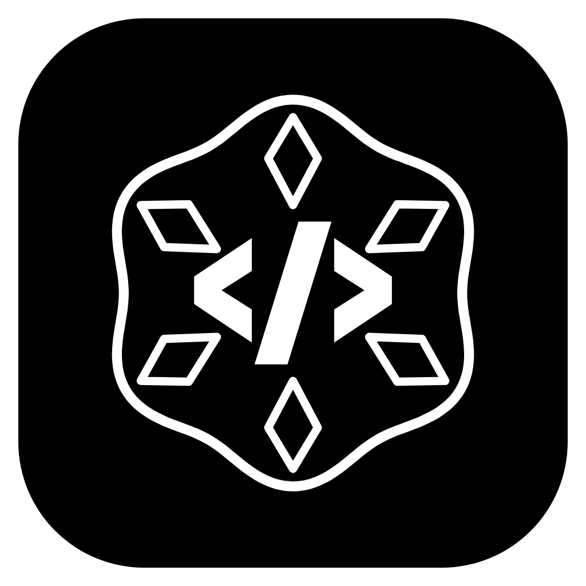
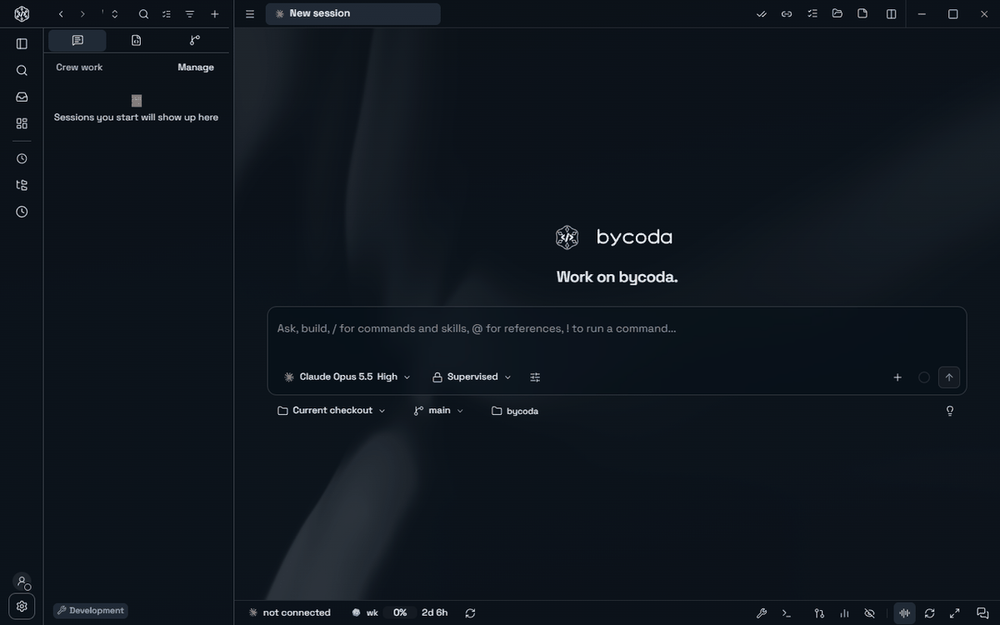
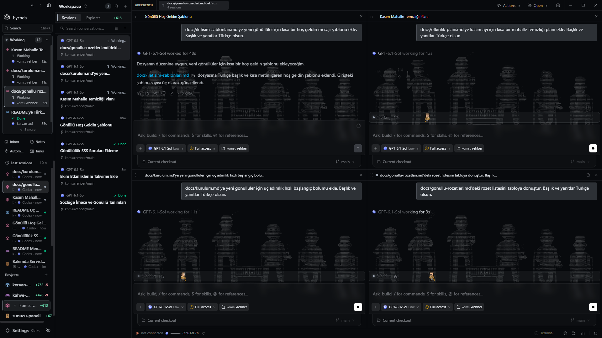
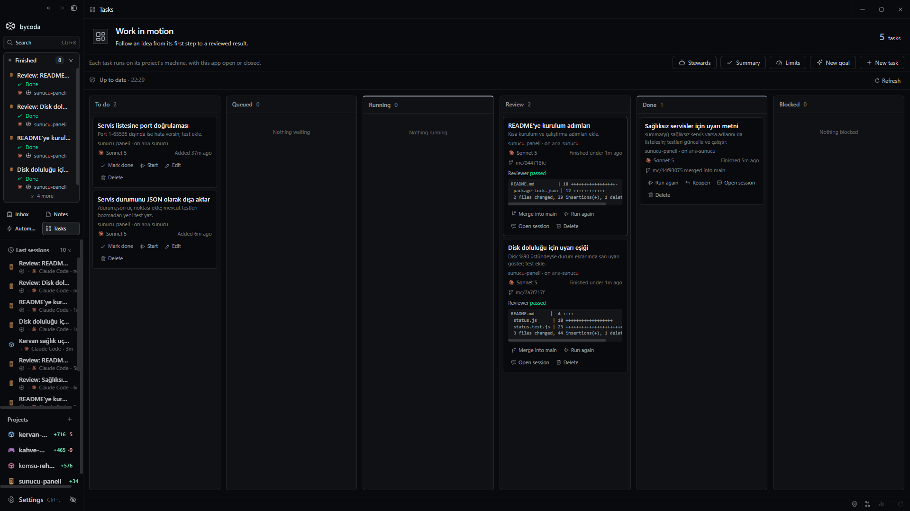

<p align="center">
  
</p>

<h1 align="center">bycoda</h1>

<p align="center">
  A desktop workspace for coding agents: sessions, files, terminals and Git in one window.
</p>

<p align="center">
  <a href="#quick-start">Quick start</a> ·
  <a href="docs/README.md">Documentation</a> ·
  <a href="https://github.com/bahadryalcn/bycoda/issues">Issues</a> ·
  <a href="LICENSE">MIT license</a>
</p>

<p align="center">
  
</p>

<p align="center"><sub>Six themes generated from one-line prompts in Settings → Appearance: midnight ocean, warm kiln, Tokyo rain, deep-space nebula, paper and ink, pine forest.</sub></p>

## Overview

bycoda runs the agent CLIs you already use (Codex, Claude Code, Gemini CLI, Cursor,
OpenCode and others) and puts their sessions next to the project they work on. You
read the conversation, open the files it touched, run commands and review the diff
without switching tools. Authentication and model access come from your own
provider accounts; bycoda does not proxy or resell AI access.

It is built with Tauri (Rust) and React, with a Node Host process that owns
sessions, projects and remote connections.

## Features

- **Sessions** — run several agents side by side, keep history per project, resume
  later. Import existing local Claude Code and Codex conversations.
- **Workspace** — file explorer, editor, document previews and terminals scoped to
  the project.
- **Source control** — Git changes, diffs, worktrees and review alongside each session.
- **Tasks and automations** — track agent work through review; schedule recurring
  runs.
- **Remote projects** — connect to a Host on another machine and work with its
  projects and sessions. See [remote access](docs/guides/remote-access.md).
- **Appearance** — light and dark schemes, palettes, fonts, density and live
  backgrounds. Describe a theme in words and a model of your choice proposes a
  complete look.
- **Localization** — multiple interface languages.

Feature availability and model options depend on the provider integration.

<table>
  <tr>
    <td><a href="public/brand/bycoda-sessions.png"></a></td>
    <td><a href="public/brand/bycoda-tasks.png"></a></td>
  </tr>
  <tr>
    <td align="center"><sub>Sessions side by side</sub></td>
    <td align="center"><sub>Tasks through review</sub></td>
  </tr>
</table>

## Quick start

Requirements:

- Node.js 24.11 or newer (see [.nvmrc](.nvmrc))
- pnpm, at the version pinned in [package.json](package.json)
- Rust and the [Tauri prerequisites](https://tauri.app/start/prerequisites/) for your platform
- At least one supported provider CLI, installed and signed in

```sh
git clone https://github.com/bahadryalcn/bycoda.git
cd bycoda
pnpm install --frozen-lockfile
pnpm run tauri dev
```

On first launch, setup walks through **Connect → Agents → Projects**: choose this
computer or a remote Host, check installed provider CLIs, then add a project folder
or import existing conversations. Nothing is installed or imported without your
choice. Details: [getting started](docs/guides/onboarding.md).

For local packaging and installation on Windows or macOS, see
[local builds](docs/local-update.md). Release builds update themselves from signed
releases; see [releases and updates](docs/reference/fork.md#releases-and-updates).

## Documentation

| Topic                                                    | Covers                                                  |
| -------------------------------------------------------- | ------------------------------------------------------- |
| [Getting started](docs/guides/onboarding.md)             | Agents, projects, importing conversation history        |
| [Remote access](docs/guides/remote-access.md)            | Working with a Host on another machine                  |
| [Project privacy](docs/guides/project-privacy.md)        | Project group locking and visibility                    |
| [Local builds](docs/local-update.md)                     | Packaging and installing on Windows and macOS           |
| [Repository layout](docs/reference/repository-layout.md) | Where application code, scripts and tests live          |
| [Documentation index](docs/README.md)                    | Integrations, localization, Host and reference material |

## Privacy

bycoda collects no telemetry. Workspace data stays on your machines and on the
services you connect. Provider subscriptions, quotas and charges are governed by
each provider's terms.

- [Privacy policy](docs/guides/privacy-policy.md)
- [Terms of use](docs/guides/terms-of-use.md)
- [Third-party services and data controls](docs/guides/third-party-data.md)

These are also available offline in **Settings → Policies** (English and Turkish).
Contact: [info@bycoda.codes](mailto:info@bycoda.codes).

## Contributing

Bug reports, feature requests and pull requests are welcome. Start with
[CONTRIBUTING.md](CONTRIBUTING.md); report security issues privately as described
in [SECURITY.md](SECURITY.md).

## Credits

bycoda began as a fork of an MIT-licensed open source project created by Nick and
has since been developed independently by
[Bahadır Halil Yalçın](https://github.com/bahadryalcn). Original and imported
contributions keep their authorship; see [CREDITS.md](CREDITS.md) and
[NOTICE](NOTICE).

## License

[MIT](LICENSE). The original copyright and license notice are preserved.
